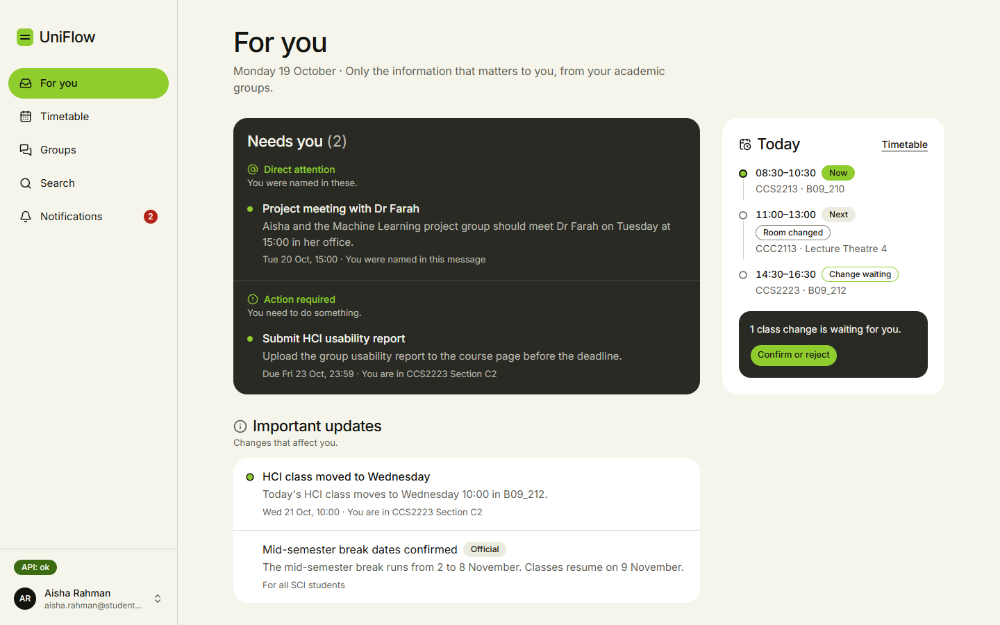
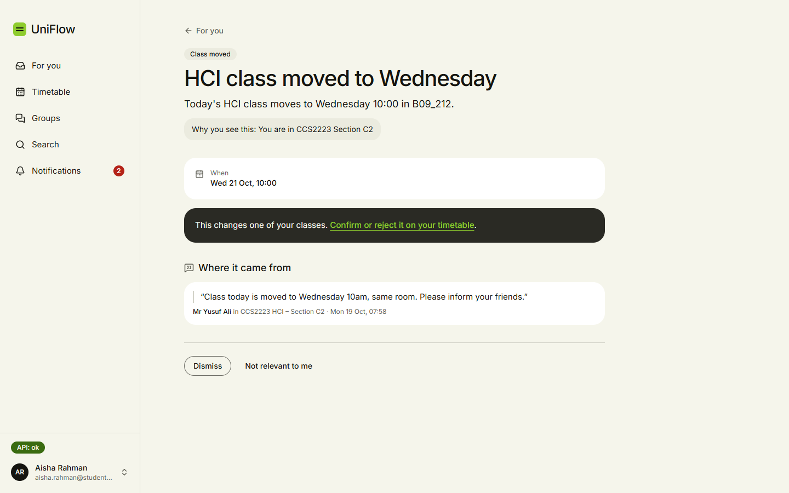
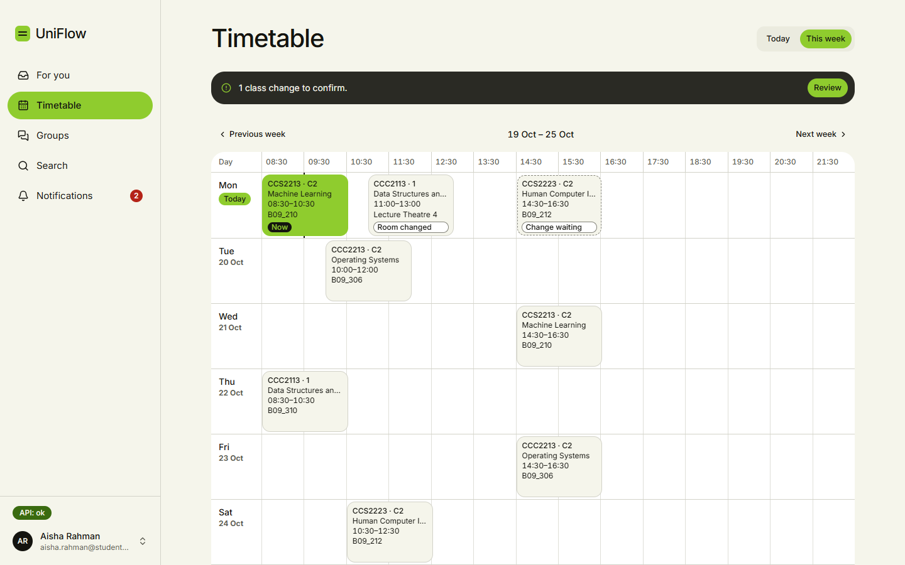
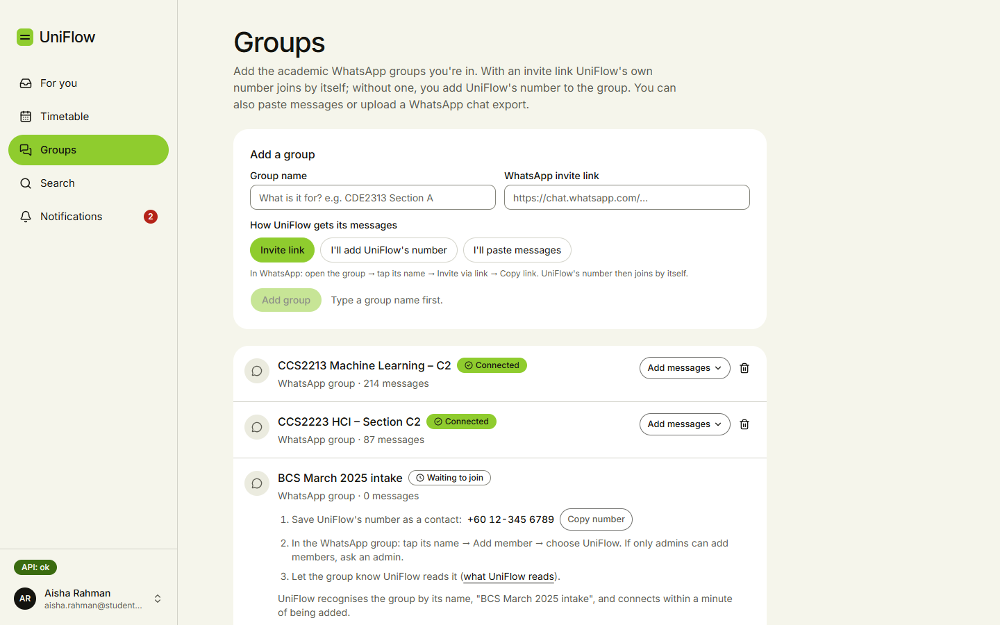
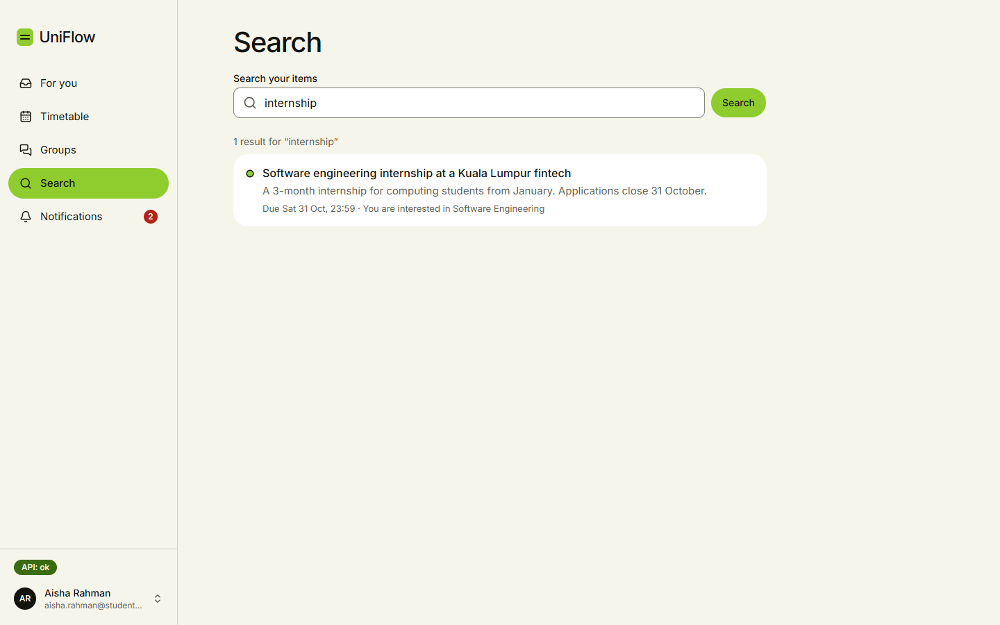
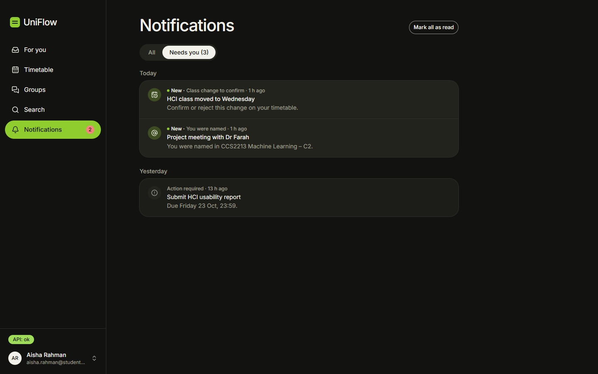
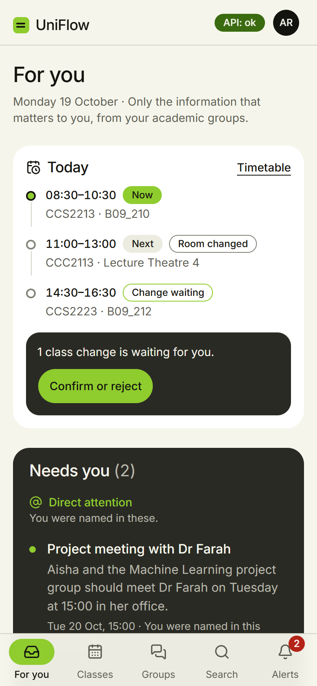
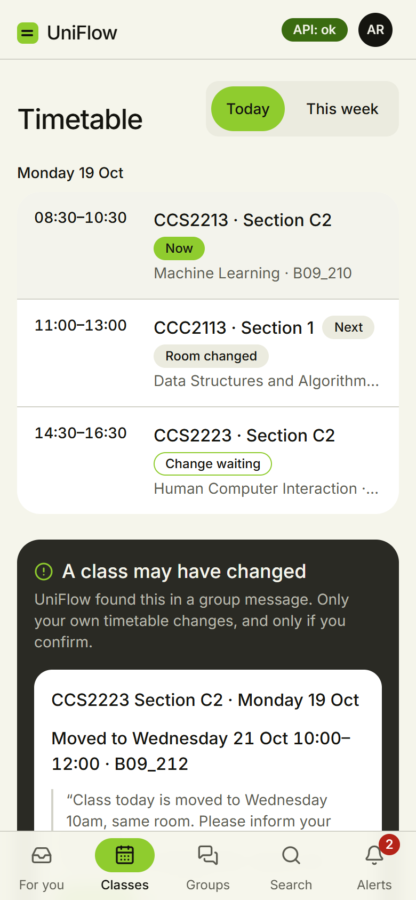
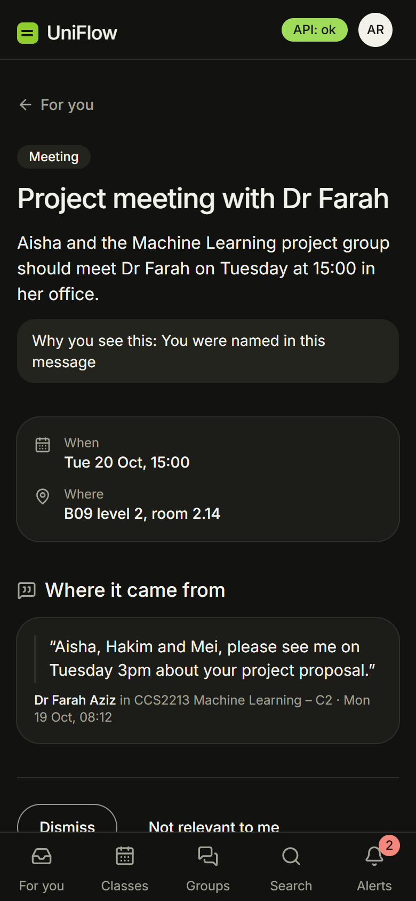

# UniFlow

UniFlow is an **AI-powered student information assistant**. It processes the university's academic WhatsApp and Telegram groups, understands what matters to each student, and brings only that into one personalized place: timetable changes, class cancellations, internships, mandatory events, notices, and messages that mention them by name.

> "No fluff. No information overload. Just the information that matters to you."

Students keep talking in WhatsApp and Telegram. UniFlow removes the need to monitor dozens of groups every day. See [docs/01-product.md](docs/01-product.md).

## Screenshots

**For you**: what needs the student's attention, today's classes, and the updates that affect them.



<table>
  <tr>
    <td width="50%"></td>
    <td width="50%"></td>
  </tr>
  <tr>
    <td><b>Announcement</b>: why the student sees it, and the group message it came from.</td>
    <td><b>Timetable</b>: the week at a glance; class changes found in group messages wait for the student to confirm.</td>
  </tr>
  <tr>
    <td></td>
    <td></td>
  </tr>
  <tr>
    <td><b>Groups</b>: connect a WhatsApp group by invite link or by adding UniFlow's number, or paste messages.</td>
    <td><b>Search</b>: find anything UniFlow has picked out for the student.</td>
  </tr>
  <tr>
    <td colspan="2"></td>
  </tr>
  <tr>
    <td colspan="2"><b>Notifications</b>, in dark mode: the ones that need the student are one tap away.</td>
  </tr>
</table>

**On a phone**

<p>
  
  
  
</p>

<sub>The screenshots use made-up sample data: no real students, staff or messages. Regenerate them with <code>npm run screens:readme</code> in <code>frontend/</code>.</sub>

## Repository layout

```
UniFlow/
├── frontend/   React + TypeScript + Vite: student area and staff dashboard
├── backend/    Django + Django REST Framework API on MySQL
├── docs/       Architecture, API design and roadmap
└── README.md
```

## Stack

- **Backend:** Python, Django 5.2 LTS, Django REST Framework, MySQL 8.4 (native install), Djoser for accounts, SimpleJWT for tokens
- **Web:** React, TypeScript, Vite, React Router, TanStack Query, Axios, Tailwind CSS, React Hook Form, Zod
- **Mobile (later):** React Native with Expo, using the same `/api/v1/` API

## Getting started

> The backend and frontend are not scaffolded yet. This section grows as each foundation task (M0) lands.

### Prerequisites

| Tool | Version | Notes |
|---|---|---|
| Git | recent | Line endings are normalized to LF by `.gitattributes` |
| Python | 3.13 | Backend |
| Pipenv | recent | Backend dependency management (`Pipfile` / `Pipfile.lock`) |
| Node.js | current LTS | Frontend |
| MySQL | 8.4 (any 8.x works) | Native local install for development (Docker is only used to run UniFlow online: `deploy/`) |
| Editor | any with [EditorConfig](https://editorconfig.org) support | Picks up `.editorconfig` automatically (VS Code needs the EditorConfig extension) |

### Setup

1. Clone the repository.
2. Create a local MySQL database named `uniflow` (see [docs/development-setup.md](docs/development-setup.md#1-local-database)).
3. Backend setup: see [backend/README.md](backend/README.md).
4. Frontend setup: added in M0.9–M0.11.

### Repository conventions

- **Configuration is scoped.** The root holds only repository-wide files: `.gitattributes`, `.editorconfig`, a `.gitignore` for OS and editor files, and `.github/`. Backend-specific configuration and ignores live in `backend/`, and frontend-specific ones in `frontend/`.
- **Line endings:** LF in the repository for all text files, except Windows `.bat` and `.cmd` scripts.
- **Indentation:** 4 spaces for Python, 2 spaces for everything else.
- **Workflow:** one small task per commit, committed directly on `main`, using [Conventional Commits](https://www.conventionalcommits.org/). See [docs/11-roadmap.md](docs/11-roadmap.md#development-workflow).

## Documentation

Start with [docs/README.md](docs/README.md). The development workflow and task list are in [docs/11-roadmap.md](docs/11-roadmap.md).
