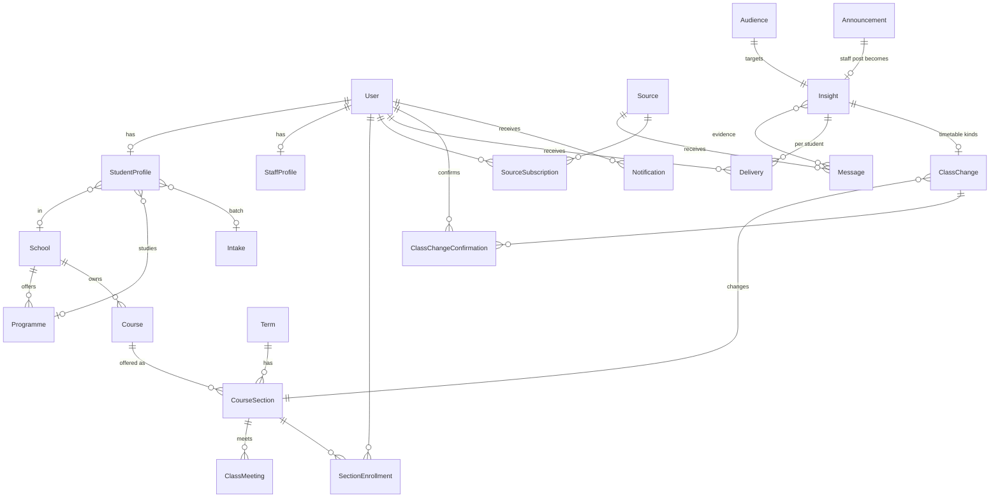

# 03 — Database & Entity Design (MySQL)

> UniFlow is an AI-powered information assistant ([01](01-product.md)). The central tables are **sources and messages** (what comes in), **insights** (what the AI understood), **deliveries** (what each student receives) and the **timetable with confirmed changes**. Staff-published content is one source among several.

## Conventions

- The primary key is `BIGINT AUTO_INCREMENT` (Django `BigAutoField`). Slugs appear only where a readable URL helps (communities).
- Every table has `created_at` and `updated_at` columns, provided by `core.TimeStampedModel`.
- Datetimes are stored in UTC. Class times are stored as `TIME` plus a weekday and are read in `TIME_ZONE` (Asia/Kuala_Lumpur).
- Categories and other fixed choices use Django `TextChoices` stored as `VARCHAR`, not lookup tables.
- Reference data is retired with `is_active = false`, and content is retired with `status = archived`. Hard deletes are only for mistakes.
- Rich text is stored as **Markdown** in `TEXT` columns.
- **[Later]** items are documented here so the MVP schema can grow into them without a redesign. They are not created in the MVP.

## Entity overview (MVP)



## accounts [MVP]

### `User` (custom, `AUTH_USER_MODEL = "accounts.User"`, created before the first migration)

| Field | Type | Notes |
|---|---|---|
| email | varchar(254), **unique** | `USERNAME_FIELD`. Stored in lowercase. |
| full_name | varchar(150) | |
| role | varchar(32), indexed | `student`, `lecturer`, `school_staff`, `university_admin` or `super_admin`. A `CheckConstraint` enforces the list. |
| is_active | bool | **Means "email verified"**, because Djoser sets it on activation |
| is_suspended | bool, default false | Blocks an account. Kept separate from `is_active` so a blocked user cannot reactivate themselves through Djoser's resend-activation endpoint. |
| is_staff | bool | Synced from `role`. It is true only for `super_admin`, and it gates the Django admin (the back-office). React staff-dashboard access comes from **capabilities** instead (see [06](06-auth-and-permissions.md)). |
| *[Later]* avatar | image, null | Deferred so the user model does not need Pillow in M0 |
| is_superuser, password, last_login, date_joined | Django | |

### `StudentProfile` (one-to-one with User)

| Field | Type | Notes |
|---|---|---|
| user | O2O, PK | |
| student_number | varchar(32), unique, null | Optional |
| school | FK → School, null, PROTECT | Chosen during onboarding |
| programme | FK → Programme, null, PROTECT | Must belong to the chosen school |
| intake | FK → Intake, null, PROTECT | |
| current_semester | smallint, null | Chosen at onboarding; used for targeting ("Year 2") |
| interests | JSON list of `Interest` choices | For example `["ai", "data_science"]`. Choices: `ai`, `data_science`, `software_engineering`, `cybersecurity`, `networking`, `business`, `education`, … (a `TextChoices` list, extended as needed) |
| info_types | JSON list of `InfoType` choices | Which kinds of information the student wants: `internship`, `bootcamp`, `industry_visit`, `competition`, `scholarship`, `academic_notice`, `student_affairs`. Empty means "all". |
| aliases | varchar(200), blank | Comma-separated nicknames, used only for direct-mention matching |
| whatsapp_number | varchar(20), null, unique | Optional, entered by the student; used only to recognise @-mentions and messages that name them |

`profile_complete` is true when the school, programme and intake are all set. Until then, the student sees only "all students" content.

### `StaffProfile` (one-to-one with User)

`school` (FK, null) and `position_title`. The school sets what a `school_staff` user may manage.

## academics [MVP]

| Model | Fields | Constraints | Built in |
|---|---|---|---|
| `School` | code, name, is_active | `code` is unique | M1 |
| `Programme` | school FK, code, name, level (foundation, diploma, bachelor, master, phd), is_active | `code` is unique | M1 |
| `Intake` | code (for example `2024-SEP`), name, start_date, is_active | `code` is unique | M1 |
| `Course` | school FK, code, name, is_active | `code` is unique | M3 |
| `Term` | name ("2025/26 Semester 1"), academic_session, number, starts_on, ends_on, is_current | `unique(academic_session, number)`, `ends_on > starts_on`, and only one row can be current (enforced in `save()` inside a transaction) | M3 |

> **Terminology (confirmed):**
> - **Programme:** the student's degree or programme of study, for example Bachelor of Computer Science.
> - **Course:** an individual subject or module, for example CDE2313.
> - **School:** an AIU academic school, from [aiu.edu.my/academic-programmes](https://aiu.edu.my/academic-programmes/). AIU has three schools (Business & Social Sciences; Education & Human Sciences; Computing and Informatics). The **Centre for Foundation and General Studies** is stored as a School too. AIU has no schools inside its schools, so every programme belongs directly to one school.

## audiences [MVP]

### `Audience`

Every insight and every staff post owns one `Audience` row through a one-to-one link. Audience rows are never shared between items. For insights, the audience is the **hard filter** of who can receive it; relevance scoring then happens per student ([12](12-intelligence.md)).

| Field | Type | Status |
|---|---|---|
| schools | M2M → School | **MVP** |
| programmes | M2M → Programme | **MVP** |
| intakes | M2M → Intake | **MVP** |
| courses | M2M → Course | **MVP** (added with courses, M3) |
| sections | M2M → CourseSection | **MVP** (added with sections, M3) |
| communities | M2M → Community (followers) | *[Later]* |
| semester_min, semester_max | smallint, null | *[Later]* |

Matching rules:

- An audience with every field empty means **all students**.
- Values within one field are combined with OR ("Computing *or* Business").
- Different non-empty fields are combined with AND ("Computing *and* the 2024-SEP intake").
- Students whose profile is incomplete match only "all students".
- In the MVP, every role except `student` sees all published content.
- **Who may set which audience** is a permission rule, not part of the model. `school_staff` audiences must stay inside their own school. See [06](06-auth-and-permissions.md#the-school-boundary-mvp-rule).

The implementation is one selector, `audiences.selectors.visible_audience_q(user) -> Q`. It builds one `Exists` subquery per field, so rows are never duplicated. Its inverse, `students_matching(audience)`, returns the students an audience covers. Adding a later field means adding a field to the model, one clause to each function, and new rows in the shared test matrix. Nothing else changes.

## publishing [MVP] — the shared base for content

`publishing.models.PublishableModel` is an abstract base:

| Field | Type | Notes |
|---|---|---|
| publisher_type | varchar | `university` or `school`. *[Later]* adds `community`. |
| publisher_school | FK → School, null | Required when the type is `school` |
| created_by, updated_by | FK → User, SET_NULL | Audit trail |
| status | varchar | `draft`, `published` or `archived` |
| published_at | datetime, null | Set by the publish service to **now**. There is no scheduling in the MVP. |
| expires_at | datetime, null | Optional. After it passes, the item leaves feeds but a direct link still works, marked as expired. |
| notified_at | datetime, null | Stops an item from notifying twice, for example after being archived and republished |
| source_platform | varchar, blank | `whatsapp`, `telegram`, `website`, `email`, `portal` or `other` |
| source_url | varchar(500), blank | |

`publishing.models.TargetedModel` is an abstract model that extends `PublishableModel` and adds `audience` (O2O → Audience). Announcements, events and applications use `TargetedModel`. **Documents use `PublishableModel` only**, because in the MVP any logged-in user can see them.

Constraints:

- A `CheckConstraint` requires `publisher_school` to be set if and only if `publisher_type = 'school'`.
- A `CheckConstraint` requires `expires_at IS NULL OR published_at IS NULL OR expires_at > published_at`.
- An index on `(status, published_at)`.

An item is **visible now** when `status = published AND (expires_at IS NULL OR expires_at > now)`.

*[Later]* adds `publish_at` for scheduling (and the cron job it needs) and `publisher_community`.

## announcements [MVP] — official staff posts

Staff posts are the **official source**. When an announcement is published, the publish service creates an `Insight` for it (kind from its category, importance from its priority, the same audience), so it reaches students through the same feed and notifications as everything else.

`Announcement(TargetedModel)`:

| Field | Type |
|---|---|
| title | varchar(200) |
| body | text (Markdown) |
| category | `university`, `school`, `student_affairs`, `club`, `event`, `registration`, `academic_info` or `general` |
| priority | `normal` or `important` |
| is_pinned | bool |
| *[Later]* attachments | M2M → Document |

Indexes: `(status, published_at)`, `(is_pinned, priority)` and `category`.

*[Later]*: `AnnouncementRead(user, announcement, read_at)` for read tracking, an `urgent` priority, and `pinned_until`.

## documents [Later]

`Document(PublishableModel)`:

| Field | Type |
|---|---|
| title, description | varchar(200), text |
| category | `notice`, `academic_calendar`, `guideline`, `form`, `event`, `school`, `handbook` or `other` |
| file | FileField (not public; only downloadable through the API) |
| original_name, mime_type, size_bytes | metadata |
| listed_in_library | bool. False means the document is only an attachment. |

**Access in the MVP:** any logged-in user may download any published document. *[Later]*: an audience field, `related_course`, and versioning.

## events [Later]

> Event information reaches students as insights (`mandatory_event`, `industry_visit`, …) with `starts_at`, `location` and `link`. A separate browsable event list with a calendar comes later.

`Event(TargetedModel)`:

| Field | Type |
|---|---|
| title, description | varchar(200), text (Markdown) |
| category | `university`, `school`, `club`, `workshop`, `seminar`, `competition`, `activity`, `orientation`, `meeting`, `sports` or `other` |
| starts_at, ends_at | datetime (a check requires `ends_at >= starts_at`) |
| is_all_day | bool |
| location_name, building, room, online_url | varchar, null |
| organizer_name | varchar, null. Overrides the publisher shown as organizer. |
| registration_url, registration_deadline | varchar, datetime, null |
| poster | image, null |
| attachments | M2M → Document |

Index: `starts_at`. *[Later]*: event "interested" markers and ICS export. RSVP and ticketing are out of scope.

## timetable [MVP] — official baseline + confirmed changes

### How timetable data flows

```
 1. University / registry supplies the timetable (email, PDF, spreadsheet, system export — format TBD)
          │
          ├─► 2a. Staff enter it through the UniFlow staff dashboard   [MVP]
          └─► 2b. An import adapter parses the supplied file → import service   [adapter: Later, once format known]
          │
 3. Later changes (room, time, lecturer, new section) → authorized staff edit in the staff dashboard   [MVP]
 4. Students pick their sections → see today / this week                                            [MVP]
```

Students **never** create the university's timetable. They choose which sections apply to them, and they **confirm or reject changes** the AI detects in messages ([12](12-intelligence.md#timetable-intelligence)). A student's timetable for a day = official meetings + their confirmed changes.

### Models

| Model | Fields | Constraints and indexes |
|---|---|---|
| `CourseSection` | course FK, term FK, code ("A", "01"), lecturer_name (text), is_active, **source** (`manual` or `import`), **external_ref** (varchar, null: the identifier from the university's data, if it has one), updated_by | `unique(course, term, code)` and `unique(term, external_ref)`. A section belongs to the school of its course. |
| `ClassMeeting` | section FK, weekday (0 is Monday, 6 is Sunday), start_time, end_time, meeting_type (`lecture`, `tutorial`, `lab`, `other`), building, room, updated_by | `end_time > start_time`, and an index on `(section, weekday)` |
| `SectionEnrollment` | user FK, section FK | `unique(user, section)` and an index on `user` |

### Changes detected from messages [MVP]

| Model | Fields | Notes |
|---|---|---|
| `ClassChange` | insight O2O, section FK, meeting FK null (null for an extra session), date, kind (`moved`, `cancelled`, `room_changed`, `extra_session`), new_start, new_end, new_room (all null when unchanged), status (`proposed`, `retracted`) | One proposal per detected change. Never edits `ClassMeeting`. Index on `(section, date)`. |
| `ClassChangeConfirmation` | change FK, user FK, status (`pending`, `confirmed`, `rejected`, `withdrawn`), decided_at | `unique(change, user)`. Created for every affected student. `withdrawn` when the change is retracted. |

*[Later]*: lecturer-confirmed changes that apply to everyone in the section without individual confirmation.

### Import service (MVP), independent of the file format

`timetable/importing.py` defines plain data classes, `SectionRow(course_code, section_code, lecturer_name, external_ref, meetings: list[MeetingRow])`, and one service:

`apply_timetable_rows(term, rows, *, user, dry_run=True) -> ImportReport`

The report lists what would be created, updated or left unchanged, plus errors with row numbers. Sections are matched by `external_ref` if the data has one, and otherwise by `(course, term, code)`. Staff review the dry-run report before anything is applied. Whatever format the university uses, an **adapter** only has to turn that file into `SectionRow`s, so choosing the format later touches one small module and one upload screen.

*[Later]*:

- The first import adapter, and an `ImportRun` model to record who imported which file.
- A `lecturer` FK on `CourseSection`, for lecturer edits.

## communities [Later]

> Replaced in the MVP by **sources** (connected groups). A browsable community directory comes later.

| Model | Fields | Constraints | Status |
|---|---|---|---|
| `Community` | name, slug, description, category (`club`, `society`, `school`, `programme`, `course`, `batch`, `interest`, `official`, `residential`), school FK null, programme FK null, intake FK null, logo, is_verified, is_active, created_by, updated_by | `slug` is unique; index on `category` | MVP |
| `CommunityLink` | community FK, platform (`whatsapp_group`, `whatsapp_channel`, `telegram_group`, `telegram_channel`, `instagram`, `facebook`, `website`, `email`, `other`), url, label, sort_order | The URL's host must match the platform (see [08](08-messaging-integrations.md)) | MVP |
| `CommunityFollow` | user FK, community FK | `unique(user, community)` | MVP |
| `CommunityManager` | user FK, community FK, added_by | `unique(user, community)` | *[Later]* |

**Who manages communities:** `school_staff` manage communities whose `school` is their own. Only a `university_admin` can manage communities that have no school, such as university-wide clubs. Community managers come later.

## applications [Later]

> Opportunities with deadlines reach students as insights (`internship`, `scholarship`, `deadline`, with `deadline_at` and `link`). A browsable applications directory comes later.

`ApplicationListing(TargetedModel)`:

| Field | Type |
|---|---|
| title, description | varchar(200), text (Markdown) |
| category | `scholarship`, `hostel`, `internship`, `event_registration`, `activity`, `university_form` or `other` |
| opens_at | datetime, null (null means open immediately) |
| closes_at | datetime, null (null means rolling, with no closing date) |
| requirements | text (Markdown) |
| apply_url | varchar(500) |
| contact_info | varchar, null |
| is_cancelled | bool |
| documents | M2M → Document |

The **status is derived and never stored**. It is one of `upcoming`, `open`, `closing_soon` (within 3 days of closing), `closed` or `cancelled`. It is computed in Python by `status_at(now)` and annotated in querysets with `Case`/`When` so lists can filter by it. A check requires `closes_at > opens_at`. There are indexes on `opens_at` and `closes_at`.

## sources [MVP] — where messages come from

| Model | Fields | Constraints and notes |
|---|---|---|
| `Source` | platform (`whatsapp_group`, `telegram_group`, `telegram_channel`, `staff`, `manual`), external_id (the platform's chat id, null for manual), title, invite_url, scope fields: school FK, programme FK, intake FK, course FK, section FK (all null), trust (`normal`, `official`), status (`pending`, `active`, `disconnected`), connected_by FK User, joined_at, notice_sent_at | `unique(platform, external_id)`. The scope helps resolve who is affected. See [08](08-messaging-integrations.md). |
| `SourceSubscription` | user FK, source FK | `unique(user, source)`. "I am in this group"; a relevance signal. |
| `Message` | source FK, external_id, sender_name, sender_ref (a hash of the sender's platform id), sender_user FK null (if the sender is a known UniFlow user), text, sent_at, reply_to FK self null, raw (JSON, platform payload), triage (`pending`, `noise`, `relevant`), processed_at, text_deleted_at | `unique(source, external_id)`, index `(source, sent_at)`. `text` and `raw` are cleared after the retention period; `text_deleted_at` records when. |

## intelligence [MVP] — what the AI understood

| Model | Fields | Constraints and notes |
|---|---|---|
| `Insight` | kind (see [12](12-intelligence.md#3-understand-conversation-aware)), title, summary, importance (0–100), action_required, action_text, info_type, topics (JSON list of `Interest` choices), starts_at, deadline_at, location, link (all null), data (JSON: the validated structured output), audience O2O → Audience, confidence (0–1), origin (`ai`, `staff`), status (`active`, `corrected`, `retracted`), model_version, prompt_version, merge_key | Index on `(status, created_at)`, `kind`, `merge_key`. |
| `InsightEvidence` | insight FK, message FK, quote (the relevant sentence, kept after the raw text is deleted) | `unique(insight, message)`. Links every insight to its original messages. |
| `InsightMention` | insight FK, user FK, matched_text | `unique(insight, user)` |
| `Delivery` | insight FK, user FK, relevance (0–100), tier (`direct`, `action`, `important`, `digest`), reason (varchar 200), notified_at, digested_at, read_at, dismissed_at, feedback (`not_relevant`, null) | `unique(insight, user)`, index `(user, tier, created_at)`. The student's feed is a query on this table. |

## core — background jobs [MVP]

| Model | Fields | Notes |
|---|---|---|
| `Job` | kind (`triage`, `extract`, `deliver`, `send_digest`, …), payload (JSON), status (`queued`, `running`, `done`, `failed`), attempts, run_after, locked_at, last_error | Index on `(status, run_after)`. Processed by `manage.py run_jobs` ([02](02-system-architecture.md#background-jobs)). |

## notifications [MVP]

`Notification`:

| Field | Type |
|---|---|
| recipient | FK → User |
| kind | `direct_attention`, `action_required`, `important_update`, `timetable_change_proposed`, `timetable_change_retracted`, `digest`, `system` |
| title, body | varchar(200), varchar(500) |
| target_type, target_id | varchar, bigint, null (for example `("insight", 42)`, which each client turns into its own route) |
| dedupe_key | varchar(100), null |
| read_at | datetime, null |

Constraints: `unique(recipient, dedupe_key)`, and an index on `(recipient, read_at, created_at)`.

*[Later]*: `Device(user, platform, token, last_seen_at)` for push notifications, and `NotificationPreference`.

## Tables deliberately not created

| Not created | Why |
|---|---|
| Category tables, a Faculty level, `Room` and `Building` | Not needed yet |
| `Assignment`, `Deadline`, `Grade`, `Submission` | Out of scope |
| `EventRSVP`, ticketing, chat or reply features | Out of scope. `Message` stores incoming group messages only; UniFlow never sends chat. |
| `Tag` | Not needed |
