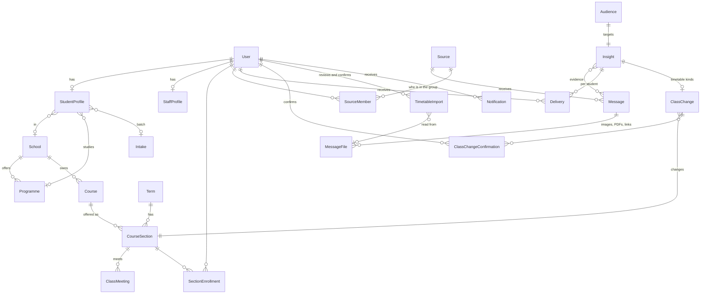

# 03 — Database & Entity Design (MySQL)

> UniFlow is an AI-powered information assistant ([01](01-product.md)). The central tables are **sources and messages** (what comes in), **insights** (what the AI understood, and official staff posts, in one table), **deliveries** (what each student receives) and the **timetable**, which is read by the AI from shared timetables and kept current with changes students confirm.

## Conventions

- The primary key is `BIGINT AUTO_INCREMENT` (Django `BigAutoField`).
- Every table has `created_at` and `updated_at` columns, provided by `core.TimeStampedModel`.
- Datetimes are stored in UTC. Class times are stored as `TIME` plus a weekday and are read in `TIME_ZONE` (Asia/Kuala_Lumpur).
- Categories and other fixed choices use Django `TextChoices` stored as `VARCHAR`, not lookup tables.
- Reference data is retired with `is_active = false`, and content is retired with `status = archived`. Hard deletes are only for mistakes.
- Rich text is stored as **Markdown** in `TEXT` columns.
- **[Later]** items are documented here so the MVP schema can grow into them without a redesign. They are not created in the MVP.

## Entity overview (MVP)



## accounts [MVP]

### `User` (custom, `AUTH_USER_MODEL = "accounts.User"`, created before the first migration)

| Field | Type | Notes |
|---|---|---|
| email | varchar(254), **unique** | `USERNAME_FIELD`. Stored in lowercase. |
| full_name | varchar(150) | |
| role | varchar(32), indexed | `student`, `lecturer`, `school_staff`, `university_admin` or `super_admin`. A `CheckConstraint` enforces the list. |
| is_active | bool | **Means "email verified"**, because Djoser sets it on activation |
| is_suspended | bool, default false | Blocks an account. Kept separate from `is_active` so a blocked user cannot reactivate themselves through Djoser's resend-activation endpoint. |
| is_staff | bool | Synced from `role`. It is true only for `super_admin`, and it gates the Django admin (the back-office). React staff-dashboard access comes from **capabilities** instead (see [06](06-auth-and-permissions.md)). |
| *[Later]* avatar | image, null | Deferred so the user model does not need Pillow in M0 |
| is_superuser, password, last_login, date_joined | Django | |

### `StudentProfile` (one-to-one with User)

| Field | Type | Notes |
|---|---|---|
| user | O2O, PK | |
| student_number | varchar(32), unique, null | Optional |
| school | FK → School, null, PROTECT | Chosen during onboarding |
| programme | FK → Programme, null, PROTECT | Must belong to the chosen school |
| intake | FK → Intake, null, PROTECT | |
| semester_override | smallint (1–15), null | Normally null: the semester is **worked out** from the intake's start date and today (`StudentProfile.current_semester`): the number of **terms** (from the `Term` table) that have started since the intake, at least 1 (`accounts/semesters.py`). AIU has three semesters a year whose dates change every year (Semester 1 started 28 Oct 2024 and 27 Oct 2025), so real term dates are used, never fixed months. AIU publishes **two calendars**: Foundation students (programme level `foundation`) count Foundation terms, everyone else Undergraduate terms. `seed_academics` loads the official terms of both calendars for 2024/2025 and 2025/2026; each new term is added in the Django admin. A student moving from Foundation to a degree updates their programme and intake to the degree's start. A student can override it (for example after a deferral). Used for targeting ("Year 2"). |
| interests | JSON list of `Interest` choices | For example `["ai", "data_science"]`. Choices: `ai`, `data_science`, `software_engineering`, `cybersecurity`, `networking`, `business`, `finance`, `education`, `psychology`, `entrepreneurship` (a `TextChoices` list, extended as needed) |
| info_types | JSON list of `InfoType` choices | Which kinds of information the student wants: `internship`, `bootcamp`, `industry_visit`, `competition`, `scholarship`, `academic_notice`, `student_affairs`. Empty means "all". |
| aliases | varchar(200), blank | Comma-separated nicknames, used only for direct-mention matching |

`profile_complete` is true when the school, programme and intake are all set. Until then, the student sees only "all students" content.

### `StaffProfile` (one-to-one with User)

`school` (FK, null) and `position_title`. The school sets what a `school_staff` user may manage.

## academics [MVP]

| Model | Fields | Constraints | Built in |
|---|---|---|---|
| `School` | code, name, is_active | `code` is unique | M1 |
| `Programme` | school FK, code, name, level (foundation, diploma, bachelor, master, phd), is_active | `code` is unique | M1 |
| `Intake` | code (for example `2025-MAR`), name, start_date, is_active | `code` is unique. AIU has **March and October** intakes (confirmed by the developer; the website only mentions October). | M1 |
| `Course` | school FK, code, name, is_active | `code` is unique | M3 |
| `Term` | calendar (`undergraduate` or `foundation`), name ("2025/2026 Semester 1"; the official terms are loaded by `seed_academics`), academic_session, number, starts_on, ends_on | `unique(calendar, academic_session, number)`, `ends_on > starts_on`. **The current term is worked out from the dates, never marked by hand** (`Term.current(calendar, date)`): during a term, that term; during a break, the next term if it is loaded, otherwise the one that just ended. The only manual job is adding each new term when AIU publishes it. | M3 |

> **Terminology (confirmed):**
> - **Programme:** the student's degree or programme of study, for example Bachelor of Computer Science.
> - **Course:** an individual subject or module, for example CDE2313.
> - **School:** an AIU academic school, from [aiu.edu.my/academic-programmes](https://aiu.edu.my/academic-programmes/). AIU has three schools (Business & Social Sciences; Education & Human Sciences; Computing and Informatics). The **Centre for Foundation and General Studies** is stored as a School too. AIU has no schools inside its schools, so every programme belongs directly to one school.

## audiences [MVP]

### `Audience`

Every insight and every staff post owns one `Audience` row through a one-to-one link. Audience rows are never shared between items. For insights, the audience is the **hard filter** of who can receive it; relevance scoring then happens per student ([12](12-intelligence.md)).

| Field | Type | Status |
|---|---|---|
| schools | M2M → School | **MVP** |
| programmes | M2M → Programme | **MVP** |
| intakes | M2M → Intake | **MVP** |
| courses | M2M → Course | **MVP** (M3.3). Matches students in a section of the course in the **current term**. |
| sections | M2M → CourseSection | **MVP** (M3.3). Matches students in that exact section. |
| communities | M2M → Community (followers) | *[Later]* |
| semester_min, semester_max | smallint, null | **MVP** (added in M3.4, with the worked-out semester): "Year 2 students" becomes semesters 4–6 (three semesters a year) |

Matching rules:

- An audience with every field empty means **all students**.
- Values within one field are combined with OR ("Computing *or* Business").
- Different non-empty fields are combined with AND ("Computing *and* the 2024-SEP intake").
- Students whose profile is incomplete match only "all students".
- Only students receive insights. Staff see insights only through review (the Django admin in the pilot).
- **Who may set which audience** is a permission rule, not part of the model. `school_staff` audiences must stay inside their own school. See [06](06-auth-and-permissions.md#the-school-boundary-mvp-rule).

The implementation is one selector, `audiences.selectors.visible_audience_q(user) -> Q`. It builds one `Exists` subquery per field, so rows are never duplicated. Its inverse, `students_matching(audience)`, returns the students an audience covers. Adding a later field means adding a field to the model, one clause to each function, and new rows in the shared test matrix. Nothing else changes.

## publishing [MVP] — the shared base for content

`publishing.models.PublishableModel` is an abstract base:

| Field | Type | Notes |
|---|---|---|
| publisher_type | varchar | `university`, `school` or `source` (an insight the AI found in a group). *[Later]* adds `community`. |
| publisher_school | FK → School, null | Required when the type is `school` |
| *(on `Insight` only)* publisher_source | FK → Source, null | Required when the type is `source`; the byline is the group's name. It lives on `Insight`, not on the shared base, because `publishing` must not depend on the `intelligence` app. |
| created_by, updated_by | FK → User, SET_NULL | Audit trail |
| status | varchar | `draft`, `published` or `archived`. For insights: **draft** = held for review, **published** = delivered to students, **archived** = retracted. |
| published_at | datetime, null | Set by the publish service to **now**. There is no scheduling in the MVP. |
| expires_at | datetime, null | Optional. After it passes, the item leaves feeds but a direct link still works, marked as expired. |
| notified_at | datetime, null | Stops an item from notifying twice, for example after being archived and republished |
| source_platform | varchar, blank | Only for staff posts that copy something from elsewhere (`whatsapp`, `telegram`, `website`, `email`, `portal`, `other`). AI insights link to their messages through `InsightEvidence` instead. |
| source_url | varchar(500), blank | |

`publishing.models.TargetedModel` is an abstract model that extends `PublishableModel` and adds `audience` (O2O → Audience). **`Insight` uses `TargetedModel`**, so AI insights and official staff posts share one table, one lifecycle and the school boundary from M2.7. *[Later]* browsable events and applications would use it too.

Constraints:

- A `CheckConstraint` requires `publisher_school` to be set if and only if `publisher_type = 'school'`. `Insight` adds one for `publisher_source` (if and only if `publisher_type = 'source'`) and one for `confidence` between 0 and 1.
- A `CheckConstraint` requires `expires_at IS NULL OR published_at IS NULL OR expires_at > published_at`.
- An index on `(status, published_at)`.

An item is **visible now** when `status = published AND (expires_at IS NULL OR expires_at > now)`.

*[Later]* adds `publish_at` for scheduling (and the cron job it needs) and `publisher_community`.

## Official staff posts [MVP]

There is **no separate announcements table**. A staff post is an `Insight` with `origin = staff`, `publisher_type = university` or `school`, and the kind, title, summary, importance and audience chosen by the staff member. Publishing it delivers it like any other insight. In the pilot, staff posts are created in the Django admin; a React form comes later.

## documents [Later]

`Document(PublishableModel)`:

| Field | Type |
|---|---|
| title, description | varchar(200), text |
| category | `notice`, `academic_calendar`, `guideline`, `form`, `event`, `school`, `handbook` or `other` |
| file | FileField (not public; only downloadable through the API) |
| original_name, mime_type, size_bytes | metadata |
| listed_in_library | bool. False means the document is only an attachment. |

**Access in the MVP:** any logged-in user may download any published document. *[Later]*: an audience field, `related_course`, and versioning.

## events [Later]

> Event information reaches students as insights (`mandatory_event`, `industry_visit`, …) with `starts_at`, `location` and `link`. A separate browsable event list with a calendar comes later.

`Event(TargetedModel)`:

| Field | Type |
|---|---|
| title, description | varchar(200), text (Markdown) |
| category | `university`, `school`, `club`, `workshop`, `seminar`, `competition`, `activity`, `orientation`, `meeting`, `sports` or `other` |
| starts_at, ends_at | datetime (a check requires `ends_at >= starts_at`) |
| is_all_day | bool |
| location_name, building, room, online_url | varchar, null |
| organizer_name | varchar, null. Overrides the publisher shown as organizer. |
| registration_url, registration_deadline | varchar, datetime, null |
| poster | image, null |
| attachments | M2M → Document |

Index: `starts_at`. *[Later]*: event "interested" markers and ICS export. RSVP and ticketing are out of scope.

## timetable [MVP] — read from shared timetables, kept current with confirmed changes

### How timetable data flows

```
 Normal weekly timetable (start of semester)
   A. A timetable image, PDF, spreadsheet or Google Drive link is shared in a connected group
   B. or a student uploads one / pastes a link on the Timetable page
          │
          ▼
   AI reads it → TimetableImport (proposed courses, sections and weekly classes)
          │
          ▼
   The student reviews "Is this your timetable?" → confirms (and can fix rows)
          │
          ▼
   import service: creates missing courses, sections and meetings (shared by everyone),
   never overwrites existing ones (conflicts go to the admin), and enrols the student

 During the semester
   A message says a class moved / was cancelled / changed room / an extra session was added
          │
          ▼
   ClassChange proposal → each affected student confirms → their timetable shows it

 Fallback: a student adds a missing class by hand; admins fix data in the Django admin.
```

The **normal timetable is read by the AI** from timetables shared in groups or uploaded by students, and **nothing is saved until a student confirms it**. Students then confirm or reject changes the AI detects in messages ([12](12-intelligence.md#timetable-intelligence)). A student's timetable for a day = the weekly meetings of their sections + their confirmed changes.

### Models

| Model | Fields | Constraints and indexes |
|---|---|---|
| `CourseSection` | course FK, term FK, code ("A", "01"), lecturer_name (text), is_active, **source** (`ai_import`, `student`, `admin` or `file_import`), created_by, **external_ref** (varchar, null: the identifier from the university's data, if it has one), updated_by | `unique(course, term, code)` and `unique(term, external_ref)`. A section belongs to the school of its course. |
| `ClassMeeting` | section FK, weekday (0 is Monday, 6 is Sunday), start_time, end_time, meeting_type (`lecture`, `tutorial`, `lab`, `other`), building, room, updated_by | `end_time > start_time`, and an index on `(section, weekday)` |
| `SectionEnrollment` | user FK, section FK | `unique(user, section)` and an index on `user` |

### Changes detected from messages [MVP]

| Model | Fields | Notes |
|---|---|---|
| `ClassChange` | insight FK, section FK, meeting FK null (null for an extra session), date, new_date (null unless moved to another day), kind (`class_moved`, `class_cancelled`, `room_changed`, `extra_session`, the same values as the insight), new_start, new_end (null when unchanged), new_room (blank when unchanged), status (`proposed`, `retracted`) | One proposal per insight **and section** (`unique(insight, section)`): one message can change several sections. Created when the insight is published, retracted when it is taken back. Never edits `ClassMeeting`. Index on `(section, date)`. |
| `ClassChangeConfirmation` | change FK, user FK, status (`confirmed`, `rejected`), decided_at | `unique(change, user)`. Saved when the student answers; no row means "not answered yet" (pending). The student can change their answer. A retraction leaves the answers as a record; the change itself is marked `retracted`. |

*[Later]*: lecturer-confirmed changes that apply to everyone in the section without individual confirmation.

### Reading timetables with AI [MVP]

| Model | Fields | Notes |
|---|---|---|
| `TimetableImport` *(in the `intelligence` app, because it points at a `MessageFile`)* | user FK (who reviews it), message_file FK (the file the classes were read from), tab (the spreadsheet tab chosen for this student; blank for images and PDFs), term FK, status (`reading`, `ready`, `confirmed`, `discarded`, `failed`), rows (JSON: the `SectionRow`s for this student), report (JSON: the dry-run result), confirmed_at | One per student per timetable. A timetable shared in a group creates one `ready` import for each member who has no sections yet, so each of them only has to confirm. |

The AI reads the image, PDF or spreadsheet into the same `SectionRow` structure the import service already uses; see below and [12](12-intelligence.md#reading-timetables). A spreadsheet is usually a whole school with **one tab per batch**: the AI's reading of each tab is stored **once on the `MessageFile`** (`MessageFile.reading`, JSON: tab name → rows, added in M5.4) and reused for every student's `TimetableImport`.

### Import service (MVP), independent of the file format

`timetable/importing.py` defines plain data classes, `SectionRow(course_code, course_name, section_code, lecturer_name, meetings: list[MeetingRow])`, `rows_from_json` (checks AI or student input and drops invalid classes; "Grp A", "Group A" and "Section A" all become section "A"), and one service:

`apply_timetable_rows(term, rows, *, user, school, enroll=False, dry_run=False) -> ImportReport`

The report lists what would be created, updated or left unchanged, plus errors with row numbers. Sections are matched by `external_ref` if the data has one, and otherwise by `(course, term, code)`. The student (or an admin) reviews the dry-run report before anything is applied. Existing shared meetings are never overwritten by an import; differences are reported to the admin. Whatever format the university uses, an **adapter** only has to turn that file into `SectionRow`s, so choosing the format later touches one small module and one upload screen.

*[Later]*:

- Adapters for the university's own timetable export, if it ever provides one.
- A `lecturer` FK on `CourseSection`, for lecturer edits.

## communities [Later]

> Replaced in the MVP by **sources** (connected groups). A browsable community directory comes later.

| Model | Fields | Constraints | Status |
|---|---|---|---|
| `Community` | name, slug, description, category (`club`, `society`, `school`, `programme`, `course`, `batch`, `interest`, `official`, `residential`), school FK null, programme FK null, intake FK null, logo, is_verified, is_active, created_by, updated_by | `slug` is unique; index on `category` | Later |
| `CommunityLink` | community FK, platform (`whatsapp_group`, `whatsapp_channel`, `telegram_group`, `telegram_channel`, `instagram`, `facebook`, `website`, `email`, `other`), url, label, sort_order | The URL's host must match the platform (see [08](08-messaging-integrations.md)) | Later |
| `CommunityFollow` | user FK, community FK | `unique(user, community)` | Later |
| `CommunityManager` | user FK, community FK, added_by | `unique(user, community)` | *[Later]* |

**Who manages communities:** `school_staff` manage communities whose `school` is their own. Only a `university_admin` can manage communities that have no school, such as university-wide clubs. Community managers come later.

## applications [Later]

> Opportunities with deadlines reach students as insights (`internship`, `scholarship`, `deadline`, with `deadline_at` and `link`). A browsable applications directory comes later.

`ApplicationListing(TargetedModel)`:

| Field | Type |
|---|---|
| title, description | varchar(200), text (Markdown) |
| category | `scholarship`, `hostel`, `internship`, `event_registration`, `activity`, `university_form` or `other` |
| opens_at | datetime, null (null means open immediately) |
| closes_at | datetime, null (null means rolling, with no closing date) |
| requirements | text (Markdown) |
| apply_url | varchar(500) |
| contact_info | varchar, null |
| is_cancelled | bool |
| documents | M2M → Document |

The **status is derived and never stored**. It is one of `upcoming`, `open`, `closing_soon` (within 3 days of closing), `closed` or `cancelled`. It is computed in Python by `status_at(now)` and annotated in querysets with `Case`/`When` so lists can filter by it. A check requires `closes_at > opens_at`. There are indexes on `opens_at` and `closes_at`.

## intelligence [MVP] — sources: where messages come from

| Model | Fields | Constraints and notes |
|---|---|---|
| `Source` | platform (`whatsapp_group`, `telegram_group`, `telegram_channel`, `staff`, `manual`), external_id (the platform's chat id, null for manual), title, invite_url, scope fields: school FK, programme FK, intake FK, course FK, section FK (all null), trust (`normal`, `official`), status (`pending`, `active`, `disconnected`), connected_by FK User, joined_at, notice_sent_at | `unique(platform, external_id)`. The scope helps resolve who is affected. The scope given by the connecting student is a **suggestion** (`scope_confirmed` false) until messages or members confirm it, or an admin does. Also: `scope_confirmed` (bool). See [08](08-messaging-integrations.md). |
| `SourceMember` | source FK, user FK, added_at | `unique(source, user)`. **The students who added this group in UniFlow** ("I am in this group"). Adding a group that is already connected just adds the student here. This is the main signal for who a message affects and for name mentions. Students never share their phone number. |
| `MessageFile` | message FK null (set when the file came from a group message), uploaded_by FK User null (set for a student's own upload or Drive link), kind (`image`, `pdf`, `spreadsheet`), file (private storage, random name), original_name, source_url (the Drive link, if any), mime_type, size_bytes, file_deleted_at | Only kinds UniFlow can read are kept (checked by real contents with `filetype`); other attachments are ignored. A Drive link is downloaded and stored like an upload. Files follow the same retention as message text. |
| `Message` | source FK, external_id, sender_name, sender_ref (a hash of the sender's platform id), text, sent_at, reply_to FK self null, raw (JSON, platform payload), triage (`pending`, `noise`, `relevant`), processed_at, text_deleted_at | `unique(source, external_id)`, index `(source, sent_at)`. `text` and `raw` are cleared after the retention period; `text_deleted_at` records when. |

## intelligence [MVP] — insights: what the AI understood

| Model | Fields | Constraints and notes |
|---|---|---|
| `Insight(TargetedModel)` | kind (see [12](12-intelligence.md#3-understand-conversation-aware)), title, summary, importance (0–100), action_required, action_text, info_type, topics (JSON list of `Interest` choices), starts_at, deadline_at, location, link (all null), data (JSON: the validated structured output), confidence (0–1; 1 for staff posts), origin (`ai`, `staff`), corrected_by FK User null, corrected_at, model_version, prompt_version, merge_key. **Inherited:** audience, publisher, status, created_by, published_at, expires_at, notified_at. | Index on `(status, published_at)`, `kind`, `merge_key`. The confidence decides the starting status ([12](12-intelligence.md#how-sure-must-the-ai-be)). |
| `InsightEvidence` | insight FK, message FK, quote (the relevant sentence, kept after the raw text is deleted) | `unique(insight, message)`. Links every insight to its original messages. |
| `InsightMention` | insight FK, user FK, matched_text (the name as written) | `unique(insight, user)`. Built in M7.2 (`mentions.py`); only students, never guessed. |
| `Delivery` | insight FK, user FK, relevance (0–100), tier (`direct`, `action`, `important`, `digest`), reason (varchar 200), notified_at, digested_at, read_at, dismissed_at, feedback (`not_relevant` or blank) | `unique(insight, user)`, index `(user, tier, created_at)`. The student's feed is a query on this table. Built in M7.4 (`delivery.py`); only created for students who should see the insight. |

## Background jobs

There is no job table: jobs are kept in **Redis** by Celery ([02](02-system-architecture.md#background-jobs)). Each job records its own outcome on the rows it works on (for example `Message.triage` and `processed_at`).

## notifications [MVP]

`Notification`:

| Field | Type |
|---|---|
| recipient | FK → User |
| kind | `direct_attention`, `action_required`, `important_update`, `timetable_change_proposed`, `timetable_change_retracted`, `digest`, `system` |
| title, body | varchar(200), varchar(500) |
| target_type, target_id | varchar, bigint, null (for example `("insight", 42)`, which each client turns into its own route) |
| dedupe_key | varchar(100), null |
| read_at | datetime, null |

Constraints: `unique(recipient, dedupe_key)`, and an index on `(recipient, read_at, created_at)`.

*[Later]*: `Device(user, platform, token, last_seen_at)` for push notifications, and `NotificationPreference`.

## Tables deliberately not created

| Not created | Why |
|---|---|
| Category tables, a Faculty level, `Room` and `Building` | Not needed yet |
| `Assignment`, `Deadline`, `Grade`, `Submission` | Out of scope |
| `EventRSVP`, ticketing, chat or reply features | Out of scope. `Message` stores incoming group messages only; UniFlow never sends chat. |
| `Announcement` | Official staff posts are `Insight` rows with `origin = staff`. |
| `Tag` | Not needed |
